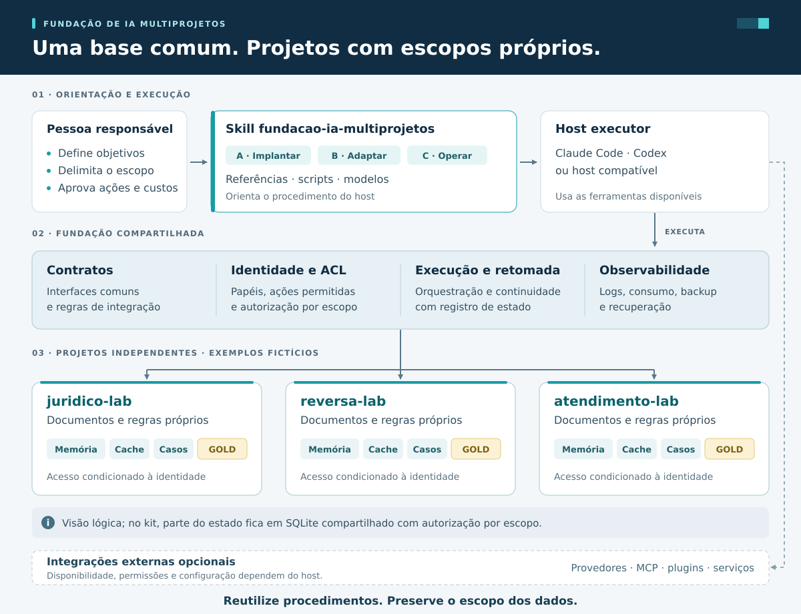
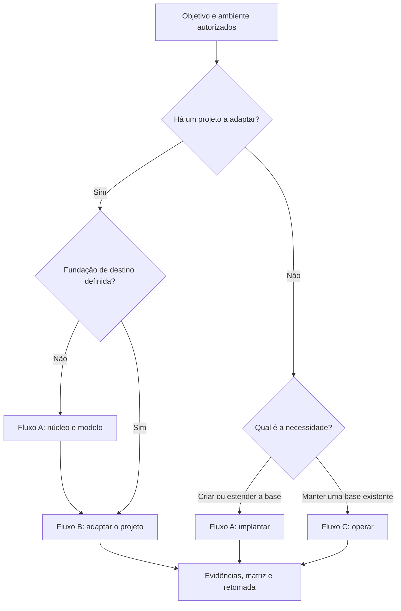
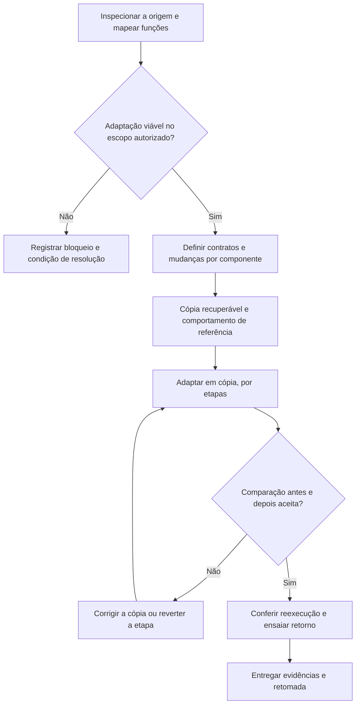
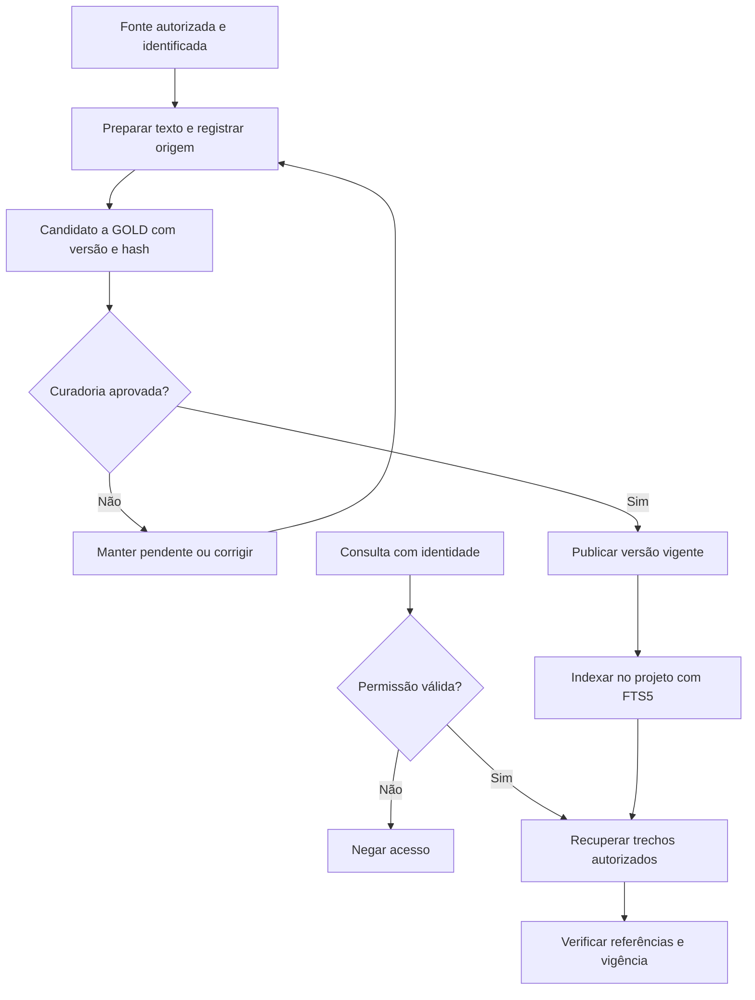

<div align="center">


# Fundação de IA Multiprojetos

**Uma base reutilizável para criar, adaptar e operar projetos com inteligência artificial.**

[](fundacao-ia-multiprojetos/SKILL.md)
[](fundacao-ia-multiprojetos/assets/fundacao-kit/fundacao/__init__.py)
[](https://github.com/opera02/fundacao-ia-multiprojetos-skill/actions/workflows/validar.yml)
[](#requisitos)
[](LICENSE)

[Instalar a skill](#instalacao) · [Experimentar o kit](#laboratorio) · [Copiar um prompt](#utilizacao) · [Consultar as evidências](#verificacao)

</div>

A **Fundação de IA Multiprojetos** orienta uma IA executora a construir uma estrutura comum de contratos, permissões, tarefas, memória, conhecimento e recuperação, mantendo o contexto de cada projeto organizado. Serve tanto para iniciar uma base quanto para trazer um sistema existente para ela e continuar sua operação ao longo de várias sessões.

O repositório entrega **uma skill no padrão Agent Skills e um kit de referência opcional em Python + SQLite**. A pessoa define objetivos, escopo e critérios de aprovação; a IA inspeciona o ambiente, implementa por etapas, verifica resultados e registra o que permite retomar o trabalho.

> **O que você instala:** a skill fornece o procedimento que a IA seguirá. O kit fornece código local para experimentar e implementar os contratos. Instalar a skill, implantar uma fundação e validar integrações reais são etapas distintas.
>
> **Versões desta entrega:** skill **1.7.5**, de **21/10/2026**, e kit **1.7.4** (correção dos cinco achados da avaliação de segurança E11 no kit — aspas tipográficas no comando que o titular cola no PowerShell, ordem das decisões assinadas, restauração com id de componente fora do formato, falha da CLI fora do teto de chamadas e desvio da rota sigilosa sem aceite assinado, com as correções da revisão de segurança dessa diferença — e da lacuna da avaliação E10 na skill: o que fazer quando a RETOMADA afirma uma conclusão falsa; antes, na 1.7.3, quinze melhorias vindas da análise do vibe-coding-toolkit; a 1.7.4 só foi empacotada). A rota habilitada inicialmente no kit é a **simulada**. Consulte o [estado de verificação](#verificacao) para distinguir código disponível, testes locais e integrações ainda não ensaiadas.

## Navegação

- [O que é e para que serve](#visao-geral)
- [Casos de uso](#casos-de-uso)
- [Capacidades disponíveis](#capacidades)
- [Arquitetura e organização dos dados](#arquitetura)
- [Como os fluxos funcionam](#fluxos)
- [Requisitos e compatibilidade](#requisitos)
- [Instalação](#instalacao)
- [Utilização e prompts prontos](#utilizacao)
- [Laboratório local: do zero à primeira tarefa](#laboratorio)
- [Comandos e APIs do kit](#comandos)
- [Memória, GOLD, RAG e CAG](#conhecimento)
- [Permissões, integrações e consumo](#operacao)
- [Atualização, retomada e recuperação](#manutencao)
- [Estrutura do repositório](#estrutura)
- [Testes, evidências e limites](#verificacao)
- [Solução de problemas](#problemas)
- [Contribuição, fontes e licença](#contribuicao)

<a id="visao-geral"></a>

## O que é e para que serve

Projetos com IA costumam começar com alguns prompts, scripts e integrações. Conforme crescem, surgem tarefas repetidas, regras dispersas, informações sem origem clara, dificuldade de retomar execuções e dependência de configurações específicas de um modelo ou ferramenta.

A fundação organiza essas responsabilidades em componentes com contratos e critérios de verificação. O objetivo é reaproveitar a estrutura técnica entre projetos, preservando suas regras, permissões e dados, e manter um registro confiável do que já foi feito e do que falta demonstrar.

| Parte | O que contém | Quando usar |
|---|---|---|
| **Skill de execução** | `SKILL.md`, fluxos, referências e critérios de conclusão | Para orientar uma IA a implantar, adaptar ou operar a fundação |
| **Kit de referência** | Código Python, CLI administrativa, SQLite, serviços e testes | Para experimentar localmente ou adotar uma implementação inicial dos contratos |
| **Modelos e ferramentas** | Diagnóstico, inventário, matriz de requisitos, planos, evidências, retomada e scripts de verificação | Para manter o trabalho reproduzível e verificável |
| **Entrega e avaliação** | Pacotes, instalador, hashes, cenários, registros e matriz de compatibilidade | Para distribuir, conferir e entender os limites da versão |

### Para quem foi pensado

- **Pessoas que delegam programação à IA:** descrevem o resultado desejado, aprovam decisões relevantes e acompanham evidências em etapas pequenas.
- **Desenvolvedores e equipes:** aproveitam contratos, modelos e testes para organizar vários projetos ou adaptar automações já existentes.
- **Operadores de agentes e squads:** precisam coordenar tarefas, controlar permissões e continuar após falhas ou interrupções.
- **Quem experimenta diferentes modelos e hosts:** quer preservar contexto e critérios de qualidade ao mudar de ferramenta, com integração demonstrada separadamente.

A metodologia deriva do livro *Fundação de IA Multiprojetos 2.0*, de autoria do titular, com as correções 3.0: **41 aulas e 60 requisitos, R01–R60**. O [mapa das aulas](fundacao-ia-multiprojetos/references/livro/indice-aulas.md) e a [matriz de rastreabilidade](entrega/rastreabilidade/MATRIZ-RASTREABILIDADE.md) mostram a relação entre os conceitos, os procedimentos e suas provas.

<a id="casos-de-uso"></a>

## Casos de uso

Os exemplos abaixo indicam aplicações do método. A configuração e a validação de cada projeto fazem parte da implantação.

| Situação | Como a fundação ajuda | Resultado que deve ser demonstrado |
|---|---|---|
| **Vários projetos paralelos** | Reutiliza núcleo, contratos e modelo de projeto | Dois projetos criados pelo mesmo modelo, com acesso e contexto próprios |
| **Pesquisa documental** | Organiza fontes, versões, curadoria GOLD e recuperação de trechos | Respostas de busca com referências vigentes e ausência de conteúdo não autorizado |
| **Automação ou squad legado** | Diagnostica dependências e adapta por interfaces ou refatoração delimitada | Comparação do comportamento antes/depois, com retorno ensaiado |
| **Engenharia de software** | Estrutura documentação técnica, tarefas, decisões e evidências | Conhecimento do projeto separado de experimentos, com critérios de aceitação registrados |
| **Fluxos longos de agentes** | Persiste tarefas, dependências, checkpoints e recibos | Continuidade após interrupção, com reconciliação dos efeitos já confirmados |
| **Atendimento e procedimentos internos** | Mantém regras revisadas, histórico e permissões por projeto | Conteúdo aprovado disponível ao operador autorizado |
| **Piloto com dois provedores** | Define rotas, contexto persistente e limites de uso | Chamadas reais identificadas por provedor e continuidade comprovada |
| **Recuperação de uma operação** | Verifica cópias e reaplica retiradas e revogações posteriores | Restauração íntegra, sem reativar acessos ou conteúdos retirados |

**Exemplo de composição:** `juridico-lab` pode estudar organização documental com casos fictícios, `reversa-lab` pode analisar software autorizado e `atendimento-lab` pode organizar procedimentos internos. O núcleo é comum; fatos, documentos e decisões permanecem nos respectivos escopos. Os exemplos jurídicos são didáticos: esta skill não redige, revisa nem libera peças ou cálculos jurídicos reais.

<a id="capacidades"></a>

## Capacidades disponíveis

| Capacidade | O que o projeto oferece | Limite ou condição |
|---|---|---|
| **Projetos por modelo** | Criação de projetos, configuração versionada e comparação da versão do modelo | Atualizar o modelo não migra automaticamente projetos existentes |
| **Identidade e permissões** | ACL para fundação, camada comum, projeto e caso; verificação nos serviços | A barreira contra acesso direto ao disco depende do ambiente de execução |
| **Orquestração persistente** | Dependências, tentativas, checkpoints, retomada, decisão humana e orçamento | As etapas do fluxo são implementadas em Python pelo integrador |
| **Agentes e subagentes** | Contratos de delegação, responsabilidades e execução de etapas independentes | Agentes nativos dos hosts exigem configuração e ensaio próprios |
| **Modelos e rotas** | Adaptadores CLI para Claude Code e Codex, adaptador simulado e política de seleção | Código dos adaptadores não comprova chamadas reais; API e modelo local exigem integração |
| **Memória** | Propostas, aprovações, revisões, vigência, retirada e promoção curada | Não sincroniza automaticamente a memória interna de aplicativos |
| **GOLD** | Fontes com origem, hash, versão, transformação e aprovação | Curadoria e aprovação não são prova automática de veracidade |
| **RAG** | Busca textual com SQLite FTS5, índices por projeto e validação de referências | Extração de documentos é externa; não inclui OCR nem busca vetorial |
| **Caches e CAG** | Cache de respostas com invalidação e demonstração separada de reutilização de estado KV | CAG com modelo real precisa de dependências, pesos locais e avaliação própria |
| **Componentes, hooks e plugins** | Registro, descoberta, habilitação por hash, desabilitação e exemplos de hooks | Instalar ou remover extensões no host é uma etapa separada |
| **MCP** | Servidor de leitura por stdio: listar projetos, listar documentos e buscar | Requer SDK; registrar e testar a conexão no host continua necessário |
| **Consumo e observabilidade** | Uso normalizado, tetos por rota, reconciliação de custo e eventos encadeados | Não há painel pronto; consumo ausente deve ser tratado como não medido |
| **Backup e recuperação** | Cópia consistente, manifesto, conferência de banco/arquivos e restauração controlada | A liberação depende também do registro protegido de retiradas |

Os contratos e critérios de prova estão nas [11 referências de capacidades](fundacao-ia-multiprojetos/references/capacidades/) e a implementação local em [`assets/fundacao-kit/`](fundacao-ia-multiprojetos/assets/fundacao-kit/).

<a id="arquitetura"></a>

## Arquitetura e organização dos dados



O desenho representa responsabilidades e escopos. No kit, parte do estado é mantida em um **SQLite compartilhado**, com autorização aplicada pelos serviços; a figura não representa um banco físico separado para cada projeto.

### Três níveis de responsabilidade

| Nível | Deve concentrar | Exemplo |
|---|---|---|
| **Fundação** | Contratos técnicos, mecanismos de permissão, execução, registro e recuperação | Coordenador de tarefas e política de rotas |
| **Projeto** | Finalidade, regras de domínio, fontes, memórias, configurações e entregas | Pesquisa documental de `pesquisa-lab` |
| **Caso ou contexto específico** | Fatos e documentos limitados a uma demanda | Um conjunto fictício de documentos dentro do projeto |

Reutilizar um procedimento não concede acesso aos fatos de outro projeto. A promoção de conhecimento para uma camada comum exige seleção, curadoria e autorização específicas.

### Onde as informações ficam no kit

| Caminho na fundação implantada | Função |
|---|---|
| `fundacao/` | Módulos Python e serviços do kit |
| `registry/` | Política de rotas, componentes e registros de instalação |
| `templates/project/` | Modelo reutilizável de projeto |
| `projects/<id>/projeto.json` | Identificação, finalidade, versão do modelo e caminhos do projeto |
| `projects/<id>/data/`, `memory/`, `evidence/`, `outputs/` | Pastas próprias de cada projeto |
| `state/state.sqlite` | Estado persistente administrado pelo kit |
| `state/retiradas.jsonl` | Registro protegido usado para preservar retiradas e revogações na recuperação |
| `evidence/` | Evidências gerais da fundação |
| `RETOMADA.md` | Continuidade do trabalho conduzido pela skill; deve ser preenchida e mantida durante o fluxo |

Fontes: [modelo de projetos](fundacao-ia-multiprojetos/assets/fundacao-kit/fundacao/core/projects.py), [inicialização da CLI](fundacao-ia-multiprojetos/assets/fundacao-kit/fundacao/__main__.py) e [modelo de retomada](fundacao-ia-multiprojetos/assets/templates/RETOMADA.md).

<a id="fluxos"></a>

## Como os fluxos funcionam

### Escolha do fluxo



| Fluxo | Quando selecionar | O que se espera ao final |
|---|---|---|
| **A — Implantar** | Criar ou estender a fundação e seu modelo | Arquitetura justificada, capacidades verificadas, projetos de exemplo, evidências e retomada |
| **B — Adaptar** | Incorporar um sistema existente, preservando o funcionamento necessário | Diagnóstico, decisão de compatibilidade, comparação antes/depois e reversão ensaiada |
| **C — Operar** | Verificar, auditar, corrigir, atualizar, retomar, promover conhecimento ou recuperar | Operação escolhida concluída ou bloqueio explicado, com estado e evidências atualizados |

O fluxo A tem etapas **A1–A8**; o B, **B1–B10**. No C, **C1–C11 são operações escolhidas conforme a necessidade**, não onze passos obrigatórios em sequência. Se a adaptação não tiver fundação de destino, o procedimento inicia A1–A6 e retorna ao B.

Leia os procedimentos completos: [Implantar](fundacao-ia-multiprojetos/references/fluxo-a-implantar.md) · [Adaptar](fundacao-ia-multiprojetos/references/fluxo-b-adaptar.md) · [Operar](fundacao-ia-multiprojetos/references/fluxo-c-operar.md).

### Como uma adaptação preserva o comportamento



Um projeto pode admitir integração direta, adaptação por interfaces, refatoração delimitada ou permanecer bloqueado nas condições atuais. A escolha depende do diagnóstico. Um exemplo fictício funcionando não substitui a prova sobre a origem que se pretende adaptar.

<a id="requisitos"></a>

## Requisitos e compatibilidade

### Requisitos por componente

| Componente | Requisito |
|---|---|
| Ler a documentação | Leitor Markdown ou navegador |
| Instalar/verificar a skill com o script | **Python 3.10+**; arquivos locais do pacote e instalador |
| Usar a skill para executar trabalho | Host compatível com Agent Skills e acesso autorizado a arquivos e ferramentas |
| Executar o kit e os scripts básicos | **Python 3.10+**, biblioteca padrão e SQLite com **FTS5**, exigido já na inicialização do kit |
| Clonar o repositório | Git; alternativamente, baixar o ZIP pelo GitHub |
| Servidor MCP opcional | Pacote **`mcp` 2.x**; a versão usada na entrega requer Python 3.11+ |
| CAG com modelo real, opcional | `torch`, `transformers`, modelo local autorizado e hardware compatível |
| Chamadas reais a provedores | CLI/adaptador instalado, autenticação válida, rota permitida e orçamento definido |

O kit básico não exige `pip install`, chave de API ou servidor de banco separado. Os requisitos das extensões opcionais devem ser tratados quando elas forem habilitadas.

**Conferência rápida do Python e do FTS5:**

```bash
python --version
python -c "import sqlite3; c=sqlite3.connect(':memory:'); c.execute('CREATE VIRTUAL TABLE teste USING fts5(texto, tokenize=' + chr(39) + 'unicode61 remove_diacritics 2' + chr(39) + ')'); print('SQLite', sqlite3.sqlite_version, '| FTS5 do kit OK')"
```

Se o interpretador instalado for chamado `python3`, use esse nome nos comandos. No Windows, `py -3` também pode ser usado quando o Python Launcher estiver disponível. O verificador da skill informa SQLite/FTS5, mas seu campo `ok` verifica a instalação; confira o teste acima antes de inicializar o kit.

### Compatibilidade registrada pelo projeto

| Ambiente | Evidência da entrega 1.7.5 | O que não está demonstrado nesse registro |
|---|---|---|
| **Windows 11 + Python 3.12.10** | Suítes, cenários, instalação e atualização em ambientes descartáveis | Uso de dados reais e integrações reais com provedores |
| **Claude Code 2.1.302** | Instalação registrada até a 1.7.5; descoberta no catálogo conferida até a 1.4.5 | Acionamento da 1.7.5 instalada em um pedido real |
| **Codex** | Estrutura e caminhos compatíveis com a documentação do host | Uso desta skill em sessão Codex |
| **Claude.ai** | ZIP específico preparado | Upload e execução deste pacote no serviço |
| **Linux/macOS; Python 3.10/3.11** | Caminhos previstos no código; simulações de condições de compatibilidade | Certificação completa nessas combinações pela entrega original |

Esta tabela resume os registros históricos, não uma promessa de funcionamento em qualquer host. Consulte a [matriz de hosts e verificações](entrega/MATRIZ-HOSTS-E-VERIFICACOES.md). Os [procedimentos oficiais dos hosts](#fontes) foram conferidos para esta documentação; o procedimento publicado pelo fornecedor não equivale a um teste deste pacote.

<a id="instalacao"></a>

## Instalação

### 1. Obter o projeto

```bash
git clone https://github.com/opera02/fundacao-ia-multiprojetos-skill.git
cd fundacao-ia-multiprojetos-skill
```

Sem Git, use **Code → Download ZIP**, extraia o conteúdo e abra o terminal na pasta que contém `README.md`, `entrega/` e `fundacao-ia-multiprojetos/`.

### 2. Escolher o pacote

| Você quer… | Arquivo |
|---|---|
| Instalar a skill localmente | [`entrega/dist/fundacao-ia-multiprojetos.skill`](entrega/dist/fundacao-ia-multiprojetos.skill) |
| Levar pacote, instalador e instruções para outro computador | [`fundacao-ia-multiprojetos-1.7.5.zip`](entrega/transferencia/fundacao-ia-multiprojetos-1.7.5.zip) |
| Fazer upload no Claude.ai | [`fundacao-ia-multiprojetos-1.7.5-para-claude-ai.zip`](entrega/transferencia/fundacao-ia-multiprojetos-1.7.5-para-claude-ai.zip) |
| Examinar também os cenários de avaliação | [`fundacao-ia-multiprojetos-completo.zip`](entrega/dist/fundacao-ia-multiprojetos-completo.zip) |
| Pedir uma revisão em texto a outra IA | [`fundacao-ia-multiprojetos-1.7.5-para-revisao.md`](entrega/transferencia/fundacao-ia-multiprojetos-1.7.5-para-revisao.md) |

O arquivo `.skill` é um ZIP com a pasta `fundacao-ia-multiprojetos/` na raiz. O pacote instalável contém **123 arquivos** e não inclui `evals/`; o completo inclui as avaliações. O arquivo `-para-revisao.md` é material de leitura, não um instalador.

### 3. Instalar para descoberta local por Claude Code e Codex

Execute na raiz do repositório:

```bash
python entrega/instalar_skill.py instalar --origem entrega/dist/fundacao-ia-multiprojetos.skill --sha256 71cb4f8c2c613ea22e8bac8fdea3c66f20be6306854fc60d14a4b09edfc9ebce
```

Depois, confira a cópia:

```bash
python entrega/instalar_skill.py verificar --origem entrega/dist/fundacao-ia-multiprojetos.skill --sha256 71cb4f8c2c613ea22e8bac8fdea3c66f20be6306854fc60d14a4b09edfc9ebce
```

**Esse instalador é compartilhado:** cria a cópia em `~/.agents/skills/fundacao-ia-multiprojetos/` e uma ligação em `~/.claude/skills/fundacao-ia-multiprojetos/`. No Windows, usa junção de diretório; nos sistemas POSIX, link simbólico. Ele não instala nem autentica os aplicativos.

A origem é conferida antes da extração contra o `--sha256` informado, obrigatório desde a 1.5.1; o [`SHA256SUMS.txt`](entrega/dist/SHA256SUMS.txt) ao lado só detecta corrupção, porque viaja junto com o pacote. O comando `verificar` compara os arquivos instalados com a origem e confere a ligação. **Isso comprova a cópia, não o acionamento no host.** Se a skill já existir, siga [Atualização](#manutencao).

O hash acima corresponde especificamente ao pacote **1.7.5**. Desde a 1.5.1, `instalar` e `atualizar` recusam sem `--sha256`. Para outra versão, use o hash publicado junto ao pacote escolhido; não substitua um hash divergente apenas para fazer a instalação continuar.

<details>
<summary><strong>Alternativa: instalação manual somente no host ou no projeto escolhido</strong></summary>

Extraia o `.skill` como ZIP, preservando sua pasta interna, para que exista exatamente um dos caminhos abaixo:

| Destino | Arquivo esperado |
|---|---|
| Claude Code, usuário | `~/.claude/skills/fundacao-ia-multiprojetos/SKILL.md` |
| Claude Code, projeto | `.claude/skills/fundacao-ia-multiprojetos/SKILL.md` |
| Codex, usuário | `~/.agents/skills/fundacao-ia-multiprojetos/SKILL.md` |
| Codex, projeto | `.agents/skills/fundacao-ia-multiprojetos/SKILL.md` |

`~` representa sua pasta de usuário. Caminhos de projeto são relativos à raiz do projeto em que o host será usado. Preserve `references/`, `scripts/` e `assets/` junto ao `SKILL.md`.

Copie a pasta da **skill**, não o repositório inteiro. Evite a duplicação `fundacao-ia-multiprojetos/fundacao-ia-multiprojetos/SKILL.md`. O verificador do instalador foi feito para a instalação compartilhada; uma instalação manual independente deve ser conferida no host escolhido.

Referências oficiais: [Claude Code](https://code.claude.com/docs/en/skills) e [Codex](https://learn.chatgpt.com/docs/build-skills).

</details>

<details>
<summary><strong>Alternativa: upload no Claude.ai</strong></summary>

1. Habilite **Code execution and file creation** em **Settings → Capabilities**. Em uma organização, as políticas de skills e execução de código também precisam permitir o recurso.
2. Acesse **Customize → Skills → + → + Create skill → Upload a skill**.
3. Envie o arquivo [`fundacao-ia-multiprojetos-1.7.5-para-claude-ai.zip`](entrega/transferencia/fundacao-ia-multiprojetos-1.7.5-para-claude-ai.zip).
4. Habilite a skill na lista e solicite seu uso explicitamente em uma conversa.

O ZIP é idêntico ao `.skill`, com extensão apropriada ao upload. O projeto preparou o arquivo, mas **não testou seu upload nem sua execução no Claude.ai**. Uma sessão na nuvem só pode atuar nos arquivos e ferramentas que realmente alcança; instalar a skill lá não concede acesso ao disco do seu computador.

Passos de interface: [central de ajuda do Claude](https://support.claude.com/en/articles/12512180-use-skills-in-claude).

**ChatGPT é outro destino.** Este repositório não entrega um plugin ChatGPT pronto nem um procedimento validado de importação no ChatGPT Web. A documentação OpenAI distingue skills locais e distribuição por plugins; não trate o ZIP preparado para Claude.ai como instalador universal.

</details>

### 4. Confirmar que a IA consegue ler a skill

No **Claude Code**, consulte `/skills` e peça:

```text
/fundacao-ia-multiprojetos Faça somente um diagnóstico de acesso: leia o SKILL.md e indique quais referências consegue abrir. Não implante a fundação ainda.
```

No **Codex CLI ou IDE**, use `/skills` ou selecione a skill com `$`:

```text
$fundacao-ia-multiprojetos Faça somente um diagnóstico de acesso: leia o SKILL.md e indique quais referências consegue abrir. Não implante a fundação ainda.
```

A seleção também pode ocorrer pela descrição do pedido. Se a skill não aparecer, consulte a [solução de problemas](#problemas). A leitura efetiva dos arquivos é um critério mais útil que apenas enxergar seu nome no catálogo.

<a id="utilizacao"></a>

## Utilização e prompts prontos

Os blocos a seguir são **pedidos para a IA**, não comandos de terminal. Substitua os caminhos pelos que o host realmente acessa. Em Windows, prefira caminhos curtos, como `D:\IA\fundacao-lab`; em Linux/macOS, use uma pasta equivalente sob seu controle.

Um bom pedido informa a raiz autorizada, o objetivo, os projetos, a identidade do responsável, o tipo de dados, as integrações permitidas e o resultado que deve ser verificado. As autorizações já fornecidas na conversa são reaproveitadas pelo fluxo.

### Criar uma fundação de laboratório

```text
Use a skill fundacao-ia-multiprojetos para implantar uma fundação em
D:\IA\fundacao-lab. Sou o titular do laboratório, com identidade titular-lab.
Quero os projetos pesquisa-lab e software-lab, somente com dados fictícios.

Pode criar e alterar arquivos nessa raiz. Não instale dependências da internet
nem faça chamadas reais a provedores. Inspecione o ambiente, justifique a
arquitetura e implemente a base por etapas verificáveis.

Demonstre criação dos projetos, persistência após reinício e negativas de
acesso entre eles. Entregue evidências, matriz R01–R60 e RETOMADA.md.
Identifique separadamente os recursos locais e as integrações pendentes.
```

### Adaptar um projeto existente

```text
Use a skill fundacao-ia-multiprojetos para adaptar D:\IA\legado à fundação
D:\IA\fundacao-lab. O projeto de destino será legado-lab. Sou o titular-lab.
Os dados são fictícios; a origem deve permanecer intacta. Trabalhe em uma
cópia em D:\IA\adaptacao-lab.

Mapeie o funcionamento, classifique a compatibilidade e documente os contratos
que devem ser preservados. Caracterize entradas, saídas, erros e regras antes
das alterações e compare os resultados após cada etapa.

Não acesse credenciais nem faça chamadas externas. Entregue o diagnóstico,
o mapa das mudanças, as provas de equivalência, a reversão ensaiada e a retomada.
```

<details>
<summary><strong>Criar outro projeto a partir do modelo</strong></summary>

```text
Na fundação de laboratório em D:\IA\fundacao-lab, crie atendimento-lab a partir
do modelo existente. Sou o administrador titular-lab. Use somente dados fictícios.

Defina operador-atendimento para operar no próprio projeto e
revisor-atendimento para revisar e aprovar, sem conceder acesso aos demais.
Demonstre a criação, as permissões e uma tentativa de acesso negada a partir
de outra identidade. Atualize a matriz e a RETOMADA.md.
```

</details>

<details>
<summary><strong>Continuar uma execução interrompida</strong></summary>

```text
Use a skill fundacao-ia-multiprojetos para retomar pesquisa-lab em
D:\IA\fundacao-lab. Leia primeiro a RETOMADA.md. A identidade autorizada já
vem do lançador; use somente o projeto indicado e dados fictícios.

Confira a tarefa, o run_id, as entradas, os hashes e os recibos persistidos.
Reconcilie efeitos confirmados antes de repetir uma etapa e retome a mesma
execução quando seus registros permitirem. Não amplie permissões ou rotas.
Explique o estado encontrado, o que foi retomado e o próximo passo.
```

</details>

<details>
<summary><strong>Preparar conhecimento para GOLD e RAG</strong></summary>

```text
Use a skill fundacao-ia-multiprojetos para preparar os documentos fictícios
que autorizei em pesquisa-lab, na fundação D:\IA\fundacao-lab.

Registre origem, versão, hash, localizador, finalidade e transformação.
Prepare candidatos a GOLD e mantenha a aprovação pendente para um curador
distinto de quem preparou o texto.

Monte perguntas de teste para resposta conhecida, ausência de resposta,
versão superada e acesso negado a outro projeto. Entregue o conteúdo revisável
e o plano de validação. Após aprovação, demonstre a recuperação e a vigência
das citações; identifique se houve busca extrativa ou geração por modelo.
```

</details>

<details>
<summary><strong>Auditar e ensaiar a recuperação</strong></summary>

```text
Use a skill fundacao-ia-multiprojetos para auditar D:\IA\fundacao-lab.
Sou o administrador titular-lab e todos os dados são fictícios.

Crie uma cópia consistente em D:\IA\backups\ensaio-001 e restaure em
D:\IA\restaurada-001, usando o registro protegido de retiradas da fundação.
Execute as provas de recuperação e isolamento na cópia restaurada.

Confira arquivos, banco, eventos, fontes e memórias retiradas, permissões
revogadas e componentes desativados. Entregue resultado esperado versus
observado, evidências e pendências. Se faltar um registro indispensável,
preserve o bloqueio e indique como resolvê-lo.
```

</details>

### O que esperar da execução

A IA deve identificar o ambiente, selecionar o fluxo, trabalhar por etapas e entregar evidências. Ao encerrar, o resultado deve apontar o que foi executado, o que foi validado, o que é simulado, os bloqueios e a próxima ação registrada em `RETOMADA.md`.

Os estados usados na matriz são `em_desenvolvimento`, `implementado_ativo`, `implementado_inativo` e `bloqueado`. Uma função só pode ser declarada implementada e inativa quando há prova anterior de funcionamento e verificação atual do desligamento. Veja [princípios e evidências](fundacao-ia-multiprojetos/references/principios-e-evidencias.md).

<a id="laboratorio"></a>

## Laboratório local: do zero à primeira tarefa

Este exercício usa apenas o kit Python, dados fictícios e uma identidade de ensaio. **Não chama modelos nem exige que a skill esteja instalada em um host.** Ele demonstra instalação do kit, persistência de uma tarefa e verificação da trilha de eventos.

Comece na raiz do repositório e escolha uma pasta nova, separada do clone. Confira Python/FTS5 na [seção de requisitos](#requisitos). Se um comando retornar erro, resolva-o antes de continuar.

### Windows — PowerShell

```powershell
# Executar inicialmente na raiz do repositório clonado.
$fundacaoRepo = (Get-Location).Path
$fundacaoLab = Join-Path (Split-Path $fundacaoRepo -Parent) "fundacao-demo"

python fundacao-ia-multiprojetos/scripts/instalar_kit.py --destino "$fundacaoLab"
Set-Location "$fundacaoLab"
python -m fundacao init --admin titular-demo

# Identidade declarada para este laboratório com dados fictícios.
$env:FUNDACAO_PRINCIPAL = "titular-demo"

python -m fundacao projeto criar --id laboratorio --nome "Laboratório" --finalidade "Ensaio local com dados fictícios"
python -m fundacao tarefa criar --projeto laboratorio --objetivo "Conferir dados fictícios" --chave demo-001
python -m fundacao status
python -m fundacao eventos verificar
```

### Linux/macOS — shell POSIX

```bash
# Executar inicialmente na raiz do repositório clonado.
fundacao_repo="$PWD"
fundacao_lab="$(dirname "$fundacao_repo")/fundacao-demo"

python3 fundacao-ia-multiprojetos/scripts/instalar_kit.py --destino "$fundacao_lab"
cd "$fundacao_lab"
python3 -m fundacao init --admin titular-demo

# Identidade declarada para este laboratório com dados fictícios.
export FUNDACAO_PRINCIPAL="titular-demo"

python3 -m fundacao projeto criar --id laboratorio --nome "Laboratório" --finalidade "Ensaio local com dados fictícios"
python3 -m fundacao tarefa criar --projeto laboratorio --objetivo "Conferir dados fictícios" --chave demo-001
python3 -m fundacao status
python3 -m fundacao eventos verificar
```

### Como conferir o resultado

A criação da tarefa devolve um `task_id`. O `status` deve identificar `titular-demo`, mostrar `laboratorio` entre os projetos autorizados e indicar uma cadeia de eventos íntegra. `eventos verificar` deve retornar `cadeia_integra: true`.

Copie o identificador retornado para consultar a tarefa:

```bash
python -m fundacao tarefa ver --projeto laboratorio --id <task_id>
```

`<task_id>` é um marcador: substitua-o pelo valor da saída, sem os sinais `<` e `>`. Repetir a criação da tarefa com a mesma chave `demo-001`, no mesmo projeto, permite conferir a idempotência. Para verificar a persistência, abra outro terminal, entre na pasta `fundacao-demo`, defina novamente a identidade de laboratório e consulte o mesmo identificador.

Esse ensaio não executa uma tarefa com modelo nem completa todos os requisitos da fundação. Orquestração, memória e conhecimento são demonstrados pelas APIs e pelos testes específicos. Para uma implantação orientada, continue com um [prompt de utilização](#utilizacao).

**Identidade em operação real:** a variável do exemplo é adequada ao laboratório fictício. Com dados reais, a identidade deve vir de um lançador controlado pelo responsável; o executor não deve poder se atribuir permissões. Veja [permissões e limites](#operacao).

<a id="comandos"></a>

## Comandos e APIs do kit

Execute os comandos abaixo **na pasta da fundação onde o kit foi instalado**. A opção global `--raiz` seleciona a raiz de dados, mas não instala o módulo Python nem resolve seu caminho de importação.

```bash
python -m fundacao --help
python -m fundacao projeto --help
python -m fundacao backup --help
```

| Objetivo | Comando ou família |
|---|---|
| Inicializar uma fundação nova | `python -m fundacao init --admin <identidade>` |
| Consultar o estado visível à identidade | `python -m fundacao status` |
| Criar um projeto | `python -m fundacao projeto criar --id <id> --nome "Nome" --finalidade "Finalidade"` |
| Listar projetos autorizados | `python -m fundacao projeto listar` |
| Comparar versão do modelo | `python -m fundacao projeto drift --id <id>` |
| Criar ou ler uma tarefa | `python -m fundacao tarefa criar ...` / `python -m fundacao tarefa ver ...` |
| Listar componentes | `python -m fundacao componente listar` |
| Habilitar ou desabilitar componente | `python -m fundacao componente habilitar --id <id>` / `desabilitar --id <id>` |
| Administrar permissões | `python -m fundacao acl registrar ...` / `conceder ...` / `revogar ...` |
| Conferir eventos | `python -m fundacao eventos verificar` |
| Exportar a trilha, com autorização | `python -m fundacao eventos exportar --destino evidence/eventos.jsonl` |
| Consultar gastos de uma rota | `python -m fundacao rota gasto --rota <rota>` |
| Reconciliar custo de uma tentativa | `python -m fundacao rota custo --rota <rota> --tentativa <event_id> --custo-usd <valor> --fonte "Origem da medição"` |
| Criar, verificar e restaurar cópias | `python -m fundacao backup criar ...` / `verificar ...` / `restaurar ...` |

Os campos entre `<...>` devem ser substituídos. `...` indica argumentos a consultar com `--help`. A CLI produz JSON; erros operacionais são informados em `stderr` com código diferente de zero. Uma restauração não liberada ou cópia inconsistente retorna código 3. A definição completa está em [`fundacao/__main__.py`](fundacao-ia-multiprojetos/assets/fundacao-kit/fundacao/__main__.py).

### Exemplo de permissão por projeto

Com a identidade administradora no laboratório:

```bash
python -m fundacao acl registrar --principal operador-demo
python -m fundacao acl conceder --principal operador-demo --recurso project:laboratorio --acao-permitida read
```

Essa concessão autoriza leitura no projeto indicado; não concede administração da fundação. Para uma prova negativa, use um segundo projeto fictício e verifique o acesso com a identidade de ensaio pelo serviço correspondente. Em ambientes reais, as identidades de cada processo devem ser controladas pelo lançador.

### Recursos acessados pela API Python

A CLI é uma interface administrativa. **Memória, GOLD/RAG, execução e retomada de workflows e despacho a provedores são APIs Python**, não subcomandos `memoria`, `rag` ou `tarefa executar`.

| Área | Implementação | Exemplos executáveis nos testes |
|---|---|---|
| Orquestração | [`core/tasks.py`](fundacao-ia-multiprojetos/assets/fundacao-kit/fundacao/core/tasks.py) | [`test_orquestracao.py`](fundacao-ia-multiprojetos/assets/fundacao-kit/tests/test_orquestracao.py) |
| Memória | [`core/memory.py`](fundacao-ia-multiprojetos/assets/fundacao-kit/fundacao/core/memory.py) | [`test_memoria.py`](fundacao-ia-multiprojetos/assets/fundacao-kit/tests/test_memoria.py) |
| GOLD e recuperação textual | [`core/knowledge.py`](fundacao-ia-multiprojetos/assets/fundacao-kit/fundacao/core/knowledge.py) | [`test_conhecimento.py`](fundacao-ia-multiprojetos/assets/fundacao-kit/tests/test_conhecimento.py) |
| Caches | [`core/cache.py`](fundacao-ia-multiprojetos/assets/fundacao-kit/fundacao/core/cache.py) | [`test_cache_backup.py`](fundacao-ia-multiprojetos/assets/fundacao-kit/tests/test_cache_backup.py) |
| Provedores e seleção de rota | [`adapters/`](fundacao-ia-multiprojetos/assets/fundacao-kit/fundacao/adapters/) e [`core/routing.py`](fundacao-ia-multiprojetos/assets/fundacao-kit/fundacao/core/routing.py) | [`test_adaptadores_rotas.py`](fundacao-ia-multiprojetos/assets/fundacao-kit/tests/test_adaptadores_rotas.py) |

<a id="conhecimento"></a>

## Memória, GOLD, RAG e CAG

Esses recursos cumprem funções diferentes no projeto:

| Termo | Papel na fundação | Exemplo |
|---|---|---|
| **Memória persistente** | Registra conhecimento e decisões aprovadas, com histórico e escopo | Uma preferência operacional validada para determinado projeto |
| **GOLD** | Organiza dados preparados e curados, com origem, versão e aprovação | Um procedimento revisado, associado à fonte e à sua vigência |
| **RAG** | Recupera trechos autorizados para compor o contexto de uma resposta | Buscar a passagem de um manual e devolver seu localizador |
| **Cache de respostas** | Reutiliza resultados quando as condições de validade continuam satisfeitas | Mesma consulta, com identidade, contexto e configuração compatíveis |
| **CAG** | Reutiliza estado de processamento de contexto em um modelo compatível | Demonstração de prefixo pré-processado e estado KV reutilizado |

### Da fonte autorizada à recuperação



O kit recebe texto já preparado; extração de PDF, OCR ou conectores precisam ser implementados ou fornecidos externamente. Sua recuperação é **lexical com FTS5**. Uma solução com embeddings ou busca vetorial pode ser adotada se preservar os contratos e for validada com os mesmos cuidados de acesso, origem e qualidade.

A conferência de referências verifica aspectos como existência e vigência. Avaliar se uma afirmação é realmente sustentada pelo trecho exige revisão adicional. Se uma fonte ou memória for retirada, os derivados e caches registrados precisam deixar de ser utilizados.

O script [`cag_kv_demo.py`](fundacao-ia-multiprojetos/scripts/cag_kv_demo.py) separa a demonstração sintética do ensaio com modelo real. **Cache de respostas e ensaio sintético de KV não comprovam CAG funcionando com um LLM real**, nem permitem prometer um percentual de economia.

Referências: [memória](fundacao-ia-multiprojetos/references/capacidades/04-memoria.md) · [GOLD](fundacao-ia-multiprojetos/references/capacidades/05-gold.md) · [RAG](fundacao-ia-multiprojetos/references/capacidades/06-rag.md) · [CAG e caches](fundacao-ia-multiprojetos/references/capacidades/07-cag-caches.md).

<a id="operacao"></a>

## Permissões, integrações e consumo

### Permissões antes de entregar conteúdo

A identidade é obtida do contexto de execução e as permissões são aplicadas pelos serviços antes de entregar dados ou realizar operações. Um `project_id` escrito no prompt não é uma credencial.

O kit oferece controles lógicos e testes de negativa. Quem consegue ler o banco diretamente, reescrever políticas ou atribuir a própria identidade fora desses serviços pode contornar essa camada. Para dados reais, a implantação precisa de uma barreira de acesso do ambiente, como contas ou serviços sob controle do responsável. Os hooks incluídos são guardas adicionais e têm limites explicitamente documentados.

Consulte [segurança e isolamento](fundacao-ia-multiprojetos/references/seguranca-isolamento.md), [privacidade e sigilo](fundacao-ia-multiprojetos/references/privacidade-sigilo.md) e o [checklist para dados reais](fundacao-ia-multiprojetos/assets/templates/CHECKLIST-DADOS-REAIS.md).

### Rotas de modelos

A política inicial fica em [`registry/route_policy.json`](fundacao-ia-multiprojetos/assets/fundacao-kit/registry/route_policy.json):

| Rota | Estado inicial | Significado |
|---|---|---|
| `simulado` | **Habilitada** | Respostas de ensaio, identificadas como simulação |
| `cli_assinatura` | Desabilitada | Uso autorizado da CLI pelo titular, conforme configuração e termos aplicáveis |
| `api_creditos` | Desabilitada | Rota prevista para API com créditos, dependente de integração e medição |
| `api_paga` | Desabilitada | Rota prevista para API paga, dependente de autorização, teto e adaptador |
| `local` | Desabilitada | Rota prevista para execução local, dependente de implementação e modelo |

Há adaptadores de código para Claude Code e Codex, mas nenhuma chamada real foi demonstrada na entrega. A presença de um nome de rota não significa que seu cliente API ou modelo local esteja pronto. O roteador recebe os adaptadores fornecidos pelo integrador.

Antes de um piloto, confirme quais rotas e modelos estão acessíveis, quem pode usá-los e qual o limite de chamadas ou custo. Uma assinatura de aplicativo não comprova direito de uso de qualquer API. Registre consumo observado; quando indisponível, use **não medido**. A referência de [provedores e modelos](fundacao-ia-multiprojetos/references/capacidades/03-provedores-modelos.md) contém o procedimento de demonstração com dois provedores.

### MCP, hooks e extensões

Com a dependência MCP instalada e a identidade autorizada definida pelo lançador, o servidor de leitura pode ser iniciado na pasta do kit:

```bash
python -m fundacao.mcp_servidor --raiz .
```

Ele usa **stdio**, portanto o comando é um processo servidor, não uma consulta que termina imediatamente. O host precisa de configuração própria para iniciá-lo e conectar-se. O kit expõe `listar_projetos`, `listar_documentos` e `buscar`; os acessos seguem a identidade configurada.

A entrega registra um ensaio local de descoberta, chamada e negativa, mas a conexão com cada host continua sendo uma verificação separada. Da mesma forma, registrar ou desabilitar um componente no kit não instala ou remove sua skill do catálogo do host. Consulte [ferramentas, hooks, MCP, skills e plugins](fundacao-ia-multiprojetos/references/capacidades/08-ferramentas-hooks-mcp-skills-plugins.md).

<a id="manutencao"></a>

## Atualização, retomada e recuperação

### Atualizar a skill

Na raiz do repositório, após obter o pacote desejado:

```bash
python entrega/instalar_skill.py atualizar --origem entrega/dist/fundacao-ia-multiprojetos.skill --sha256 71cb4f8c2c613ea22e8bac8fdea3c66f20be6306854fc60d14a4b09edfc9ebce
python entrega/instalar_skill.py verificar --origem entrega/dist/fundacao-ia-multiprojetos.skill --sha256 71cb4f8c2c613ea22e8bac8fdea3c66f20be6306854fc60d14a4b09edfc9ebce
```

A versão anterior é guardada em `~/.agents/skills-anteriores/`. A troca usa preparação, verificação e renomeações com mecanismo de retorno e recuperação de interrupção; não é descrita como uma única troca atômica. Para voltar, use `atualizar --origem` com a cópia anterior ou o pacote correspondente e confira sua integridade. **Não existe subcomando `rollback`.**

Atualizar a skill não atualiza automaticamente o kit já copiado para uma fundação; desde a 1.5.1, isso é feito em um comando: `python <skill>/scripts/atualizar_fundacao.py aplicar --raiz <raiz> --backups <pasta em outro disco>` (backup antes, ensaio numa cópia restaurada, promoção, backup depois e registro; `checar` só lê). A versão da skill e a do kit são independentes: a do kit sobe quando seus próprios arquivos mudam.

### Atualizar o kit ou o modelo de projeto

Primeiro, faça uma cópia recuperável e confira o plano:

```bash
python fundacao-ia-multiprojetos/scripts/instalar_kit.py --destino <raiz-da-fundacao> --simular
```

Um conflito de arquivos locais exige uma decisão; sem ela, nada deve ser sobrescrito. Após revisar o plano, o fluxo C6 usa `--atualizar`, guarda o código anterior em `registry/kit_backup/` e preserva a configuração local. Na fundação, `init` aplica as migrações necessárias; depois devem ser conferidos o estado e os testes. Veja o [procedimento de operação](fundacao-ia-multiprojetos/references/fluxo-c-operar.md).

Alterar o modelo em `templates/project/` também não migra instâncias por conta própria. Use `projeto drift --id <id>` para identificar diferenças de versão e trate a migração como trabalho específico.

### Retomar uma sessão

`RETOMADA.md` registra objetivo, versões, estado confirmado, evidências, bloqueios, próxima ação e **efeitos já realizados**. Depois de uma interrupção, comece por ela e pelos registros persistidos:

```text
Retome a fundação em D:\IA\fundacao-lab a partir da RETOMADA.md.
Confira as evidências e os efeitos já realizados antes de repetir ações.
```

A skill fornece um [validador de retomada](fundacao-ia-multiprojetos/scripts/retomada.py):

```bash
python fundacao-ia-multiprojetos/scripts/retomada.py validar --arquivo <raiz-da-fundacao>/RETOMADA.md
```

A retomada de efeitos externos exige idempotência no destino ou reconciliação por recibos. O registro local, sozinho, não garante que qualquer serviço externo executará uma operação uma única vez.

### Criar, verificar e restaurar uma cópia

Exemplo para o laboratório, executado dentro de `fundacao-demo`, com identidade administradora. Os destinos devem ser pastas novas e separadas da origem:

```bash
python -m fundacao backup criar --destino ../fundacao-demo-backup --rotulo ensaio-readme
python -m fundacao backup verificar --origem ../fundacao-demo-backup
python -m fundacao backup restaurar --origem ../fundacao-demo-backup --destino ../fundacao-demo-restaurada --retiradas state/retiradas.jsonl
```

A conferência inclui arquivos e banco contra o manifesto. A restauração utiliza o registro protegido atual para reaplicar retiradas, revogações e desativações relevantes. Confira a resposta: uma restauração não liberada não está pronta para uso.

Se o banco de uma fundação existente tiver sido perdido, siga a recuperação; executar `init` para criar estado vazio não recupera o que desapareceu. Detalhes e tratamento de cópias antigas: [manutenção e recuperação](fundacao-ia-multiprojetos/references/capacidades/11-manutencao-recuperacao.md).

### Remover a instalação compartilhada da skill

O comando abaixo remove a cópia pessoal em `~/.agents/skills/`, sua ligação em `~/.claude/skills/` e sobras de preparo. Ele também pode remover uma **cópia manual** em `~/.claude/skills/fundacao-ia-multiprojetos/` quando seu `SKILL.md` declara o nome canônico. Preserve alterações locais que queira manter antes de executá-lo.

Na raiz do repositório:

```bash
python entrega/instalar_skill.py remover --confirmar
```

As versões guardadas em `~/.agents/skills-anteriores/` permanecem. A remoção não apaga fundações e projetos criados em outras pastas. Instalações manuais em outros destinos devem ser tratadas separadamente.

<a id="estrutura"></a>

## Estrutura do repositório

| Caminho | Conteúdo |
|---|---|
| [`fundacao-ia-multiprojetos/SKILL.md`](fundacao-ia-multiprojetos/SKILL.md) | Entrada da skill, seleção de fluxo, regras e mapa de referências |
| [`references/`](fundacao-ia-multiprojetos/references/) | Fluxos, capacidades, requisitos, segurança e fontes |
| [`references/livro/`](fundacao-ia-multiprojetos/references/livro/) | Sínteses por módulo, glossário, padrões e correções 3.0 |
| [`scripts/`](fundacao-ia-multiprojetos/scripts/) | Inventário, instalação do kit, matrizes, retomada, backup e ensaios |
| [`assets/fundacao-kit/`](fundacao-ia-multiprojetos/assets/fundacao-kit/) | Implementação local e suíte de conformidade |
| [`assets/templates/`](fundacao-ia-multiprojetos/assets/templates/) | Modelos de diagnóstico, decisão, adaptação, evidência e retomada |
| [`assets/hooks/`](fundacao-ia-multiprojetos/assets/hooks/) | Guardas exemplificativos de caminho e identidade |
| [`evals/`](fundacao-ia-multiprojetos/evals/) | Cenários determinísticos, avaliação de acionamento e projetos fictícios |
| [`entrega/dist/`](entrega/dist/) | Pacotes instaláveis, hashes e versões anteriores |
| [`entrega/transferencia/`](entrega/transferencia/) | Pacotes de transferência e material de revisão |
| [`entrega/testes/`](entrega/testes/) | Testes do instalador, empacotador e ferramentas de entrega |
| [`entrega/rastreabilidade/`](entrega/rastreabilidade/) | Mapeamento R01–R60 para implementação e critérios |
| [`entrega/avaliacoes/`](entrega/avaliacoes/) | Registros de avaliação e resultados históricos |
| [`docs/assets/`](docs/assets/) | Capa ilustrativa e diagrama deste README |

Para se aprofundar: [guia de entrega](entrega/README-ENTREGA.md) · [árvore detalhada](entrega/ARVORE-SKILL.md) · [glossário](fundacao-ia-multiprojetos/references/livro/glossario.md) · [requisitos](fundacao-ia-multiprojetos/references/requisitos.md).

<a id="verificacao"></a>

## Testes, evidências e limites

### Resultados registrados na entrega 1.7.5

Os números abaixo são o registro histórico em **Windows 11, Python 3.12.10**. Devem ser lidos com suas condições, e não como uma certificação geral de produção.

| Verificação | Resultado registrado | Alcance |
|---|---|---|
| Kit de referência | Suíte com **355 testes**, sem falhas e com **5 pulados** | Testes locais positivos e negativos; os pulados dependiam de links simbólicos de arquivo ou do bash do Linux/WSL |
| Scripts da skill | **188 testes**, sem falhas e com **2 pulados** (um só roda como administrador) | Ferramentas locais, inclusive o preparo do host num PowerShell e num bash do Git de verdade, as instruções da raiz e a catraca da atualização |
| Ferramentas de entrega | **96 testes**, sem falhas e com **2 pulados** | Instalação, empacotamento, regressões e a CI pública |
| Cenários CEN-01–CEN-16 | **16/16**, com **112/112 verificações** no ambiente registrado | Incluem condições simuladas identificadas; algumas dependem de ferramentas externas |
| Referências da árvore | **351 conferidas, 0 ausentes** | Integridade dos caminhos internos conferidos pela ferramenta |
| Validação estrutural | `quick_validate` válido na árvore e no pacote | Formato e estrutura; não comprova acionamento no host |
| MCP por stdio | Descoberta, chamada, negativa e encerramento conferidos | Ensaio local com SDK disponível; não comprova a integração em cada aplicativo |

Fontes: [guia de entrega](entrega/README-ENTREGA.md), [matriz de hosts](entrega/MATRIZ-HOSTS-E-VERIFICACOES.md), [avaliações](entrega/avaliacoes/AVALIACOES.md) e [cenários da versão 1.7.5](entrega/avaliacoes/cenarios/RESULTADOS-versao-1.7.5.md).

**Conferência adicional da documentação da 1.4.5:** em Linux com Python 3.12.14, as três suítes coletaram 229 testes: **223 aprovados, 6 pulados e nenhuma falha**. Também foram conferidas 28 chamadas de CLI, incluindo negativas esperadas, instalação, atualização, criação de projeto/tarefa, backup e restauração. Esse ensaio não valida o acionamento da skill nos hosts. Ambiente, comandos e limites estão no [registro da revisão do README](docs/VERIFICACAO-README.md).

### Reproduzir as verificações locais

Na raiz do repositório:

```bash
python -B fundacao-ia-multiprojetos/scripts/verificar_referencias.py
python -B -m unittest discover -s fundacao-ia-multiprojetos/scripts/tests
python -B -m unittest discover -s entrega/testes
```

Para a suíte do kit, entre na pasta que contém seu módulo:

```bash
cd fundacao-ia-multiprojetos/assets/fundacao-kit
python -B -m unittest discover -s tests
```

A mesma suíte pode ser executada dentro de uma fundação de laboratório em que o kit tenha sido instalado. As provas usam diretórios temporários e dados fictícios; resultados dependentes de sistema operacional, links ou SDKs podem aparecer como pulados. Um teste pulado deve continuar identificado como tal.

Os cenários adicionais e validadores externos têm requisitos próprios. Siga os [arquivos de avaliação em `evals/`](fundacao-ia-multiprojetos/evals/) e o [procedimento de avaliações](entrega/avaliacoes/AVALIACOES.md), sem interpretar ausência de dependência como aprovação.

### Limites que fazem parte desta entrega

- **Integrações reais:** não foram demonstradas chamadas a provedores, continuidade real entre dois LLMs ou CAG com um modelo real.
- **Interfaces:** não há dashboard, interface de conversa pronta ou cliente universal de APIs incluído no kit.
- **Dados e documentos:** o método usa cenários fictícios; extração/OCR e acesso a sistemas externos são componentes a integrar.
- **Execução em hosts:** código local funcionando, skill instalada, catálogo atualizado e acionamento real são provas diferentes.
- **Isolamento:** ACLs, hooks e hashes locais não substituem a proteção do sistema operacional nem tornam registros invioláveis para quem controla o disco.
- **Migração:** fixtures e cenários não comprovam que um projeto real já foi adaptado; isso exige análise da origem.

### Sobre esta cópia pública

Este repositório é uma cópia saneada do desenvolvimento, publicada por decisão do titular. Nos textos, nomes de usuário, máquina e caminhos locais foram substituídos por marcadores. O workspace de desenvolvimento e a pasta `entrega/auditoria/` não foram publicados.

Os pacotes em `dist/` e `transferencia/` foram preservados byte a byte; os hashes publicados continuam vinculados a eles. Menções a `auditoria/…` ou ao workspace nos documentos históricos referem-se a arquivos do projeto original que não acompanham esta cópia.

O histórico da entrega descreve auditorias e correções das versões anteriores. Os testes de regressão publicados permitem examinar várias dessas correções; os relatórios externos omitidos não devem ser apresentados como documentos disponíveis aqui.

<a id="problemas"></a>

## Solução de problemas

| Sintoma | O que conferir |
|---|---|
| `python` não encontrado | Instalação e nome do interpretador; tente `python3` ou, no Windows com Launcher, `py -3` |
| `No module named fundacao` | Entre na pasta em que o kit foi instalado, onde existe `fundacao/`; só passar `--raiz` não resolve a importação |
| `no such module: fts5` | O SQLite da instalação Python precisa oferecer FTS5; refaça a conferência dos requisitos |
| Skill não aparece no catálogo | Caminho exato do `SKILL.md`, integridade das referências e ausência de pasta duplicada; confira a recarga do host |
| Claude Code não reconhece uma pasta criada após o início da sessão | Use `/reload-skills` ou abra nova sessão, conforme a [documentação do host](https://code.claude.com/docs/en/skills) |
| Codex não mostra a atualização | Confira `.agents/skills` e reinicie o Codex se a alteração não aparecer, conforme a [documentação oficial](https://learn.chatgpt.com/docs/build-skills) |
| Claude.ai não permite upload | Confira execução de código, permissões organizacionais e o ZIP específico; esse destino não foi validado pela entrega |
| Instalação já existente | Use `atualizar`, depois `verificar`; não force uma extração sobre a cópia existente |
| Hash divergente | Confirme a versão, o arquivo e o `SHA256SUMS.txt` correspondente; obtenha novamente o pacote se necessário |
| `FUNDACAO_PRINCIPAL` ausente ou acesso negado | Confira a identidade do lançador e a permissão sobre o recurso; não amplie acesso apenas para eliminar o erro |
| Projeto já existe | A criação não sobrescreve o projeto anterior; use outro identificador ou opere a instância existente |
| Conflito na atualização do kit | Leia o plano; a recusa sem escrita permite decidir como preservar alterações locais |
| MCP indisponível | Confira SDK compatível, identidade, comando stdio e configuração do host; instalar a skill não registra o servidor |
| Restauração não liberada | Confira a origem e a identidade do registro de retiradas; siga o fluxo de recuperação antes de usar o destino |

Para dúvidas ou problemas reproduzíveis, abra uma [issue](https://github.com/opera02/fundacao-ia-multiprojetos-skill/issues) com versão da skill/kit, sistema, Python, comando, resultado esperado e saída sanitizada.

<a id="contribuicao"></a>

## Contribuição, fontes e licença

### Como contribuir

Contribuições úteis incluem melhorias de documentação, correções reproduzíveis, novos testes de contrato, ensaios de compatibilidade e adaptadores que preservem os critérios de acesso, rastreabilidade e recuperação.

1. Descreva a necessidade em uma issue ou no contexto do pull request.
2. Trabalhe em uma branch com uma alteração delimitada.
3. Verifique os comandos e testes relacionados ao comportamento modificado.
4. Registre ambiente, resultado observado e limitações; se houver simulação ou testes pulados, identifique-os.
5. Atualize as referências afetadas. Mudanças no conteúdo distribuído da skill exigem rever versão, pacotes e hashes pelo [procedimento de entrega](entrega/README-ENTREGA.md).

Use dados fictícios e saídas sanitizadas nos exemplos e reproduções. Melhorias restritas a este README e suas imagens não alteram, por si, os pacotes instaláveis.

<a id="fontes"></a>

### Fontes e documentação

| Tema | Referência |
|---|---|
| Padrão de estrutura | [Agent Skills Specification](https://agentskills.io/specification) |
| Instalação e invocação no Claude Code | [Extend Claude with skills](https://code.claude.com/docs/en/skills) |
| Upload e uso no Claude.ai | [Use skills in Claude](https://support.claude.com/en/articles/12512180-use-skills-in-claude) |
| Skills locais e distribuição no ecossistema OpenAI | [Build skills](https://learn.chatgpt.com/docs/build-skills) |
| Decisões técnicas e fontes datadas do projeto | [Fontes verificadas](fundacao-ia-multiprojetos/references/fontes-verificadas.md) |
| Origem pedagógica e correções | [Índice do livro](fundacao-ia-multiprojetos/references/livro/indice-aulas.md) e [correções 3.0](fundacao-ia-multiprojetos/references/livro/correcoes-3.0.md) |

A documentação dos hosts foi consultada em **19/10/2026** para esta revisão. Reconfirme comandos, formatos, autenticação e condições de uso antes de configurar integrações, especialmente quando houver consumo de cotas ou cobrança.

### Licença

Distribuído sob a **[Licença MIT](LICENSE)**. O pacote da skill também contém o [texto da licença](fundacao-ia-multiprojetos/LICENSE.txt).

A capa é uma ilustração conceitual gerada para esta documentação; a arquitetura em SVG e os fluxogramas Mermaid descrevem o projeto e podem ser mantidos junto ao texto.

[Voltar ao início](#fundação-de-ia-multiprojetos)
